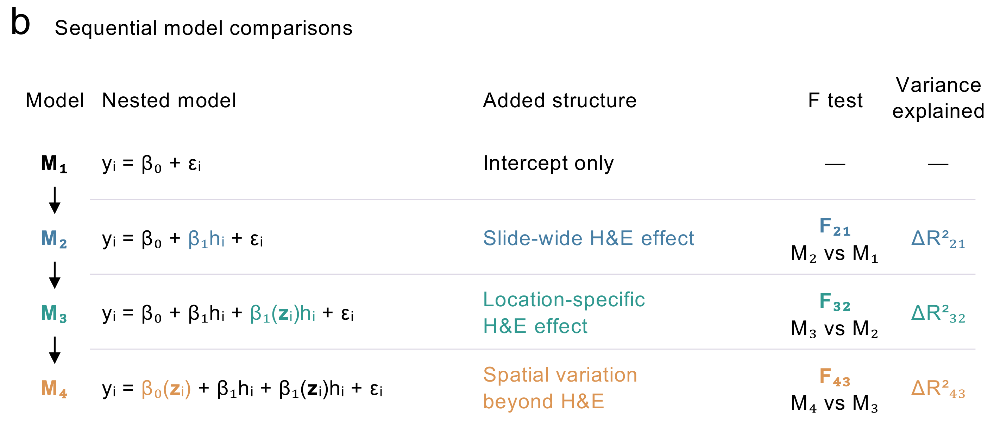

# MorphoANOVA 

MorphoANOVA relates spatial gene expression to H&E morphology. It
separates expression into a **slide-wide H&E effect**, a
**location-specific H&E effect**, and **spatial variation beyond H&E**.



## Usage

With [**MorphoANOVA**](https://github.com/powei219/MorphoANOVA), you can:

- Extract morphological features from H&E images at tissue spots or cells.
- Quantify slide-wide and location-specific associations between morphology
  and gene expression, alongside spatial variation beyond H&E.
- Visualize spatial expression patterns, highlight locations with significant total H&E effects or spatial effects beyond H&E, and explore associations with tissue composition and biological pathways.

Fitting uses two inputs:

- `expression`: a normalized or transformed **genes × locations** matrix,
  with gene names as row names and spot or cell IDs as column names.
- `spots`: a data frame with columns `spot_id`, `x`, `y`, and `he`.
  Each row contains one location's ID, coordinates, and scalar H&E feature.

Inputs are matched by spot ID. Each fit analyzes one tissue section.
Once the two inputs are prepared:

``` r
library(MorphoANOVA)

fit <- fit_morphoanova(expression, spots, genes = "IGHM")
fit$statistics
head(fit$spatial[["IGHM"]][c("spot_id", "slide_wide_he", "location_specific_he", "spatial_beyond_he")])
plot_components(fit, gene = "IGHM")
```

## Installation

``` r
install.packages(c("remotes", "ggplot2", "patchwork", "png", "jpeg", "ggrepel"))
remotes::install_github("powei219/MorphoANOVA")
```

## Tutorial

The [ovarian cancer tutorial](tutorial/MorphoANOVA-tutorial.md) shows the
complete workflow with real data: preparing the inputs, extracting the H&E
feature, fitting single and multiple genes, interpreting the statistics,
plotting components and significance maps, ranking genes, and downstream
analyses.

Download [the expression and coordinate data](tutorial/data/ovarian_full.rds)
and [the H&E image](tutorial/data/tissue_hires_image.png) to follow the tutorial.
The executable R Markdown source is [available here](tutorial/MorphoANOVA.Rmd).

MorphoANOVA is distributed under GPL-3.0-or-later. The ovarian
expression and histology data are from 10x Genomics under CC BY 4.0.
