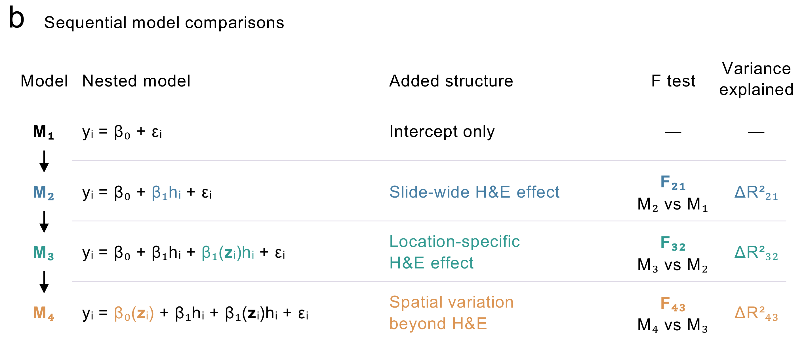
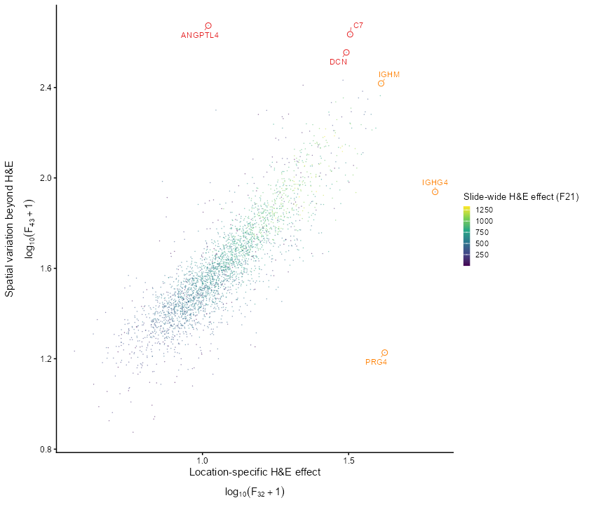
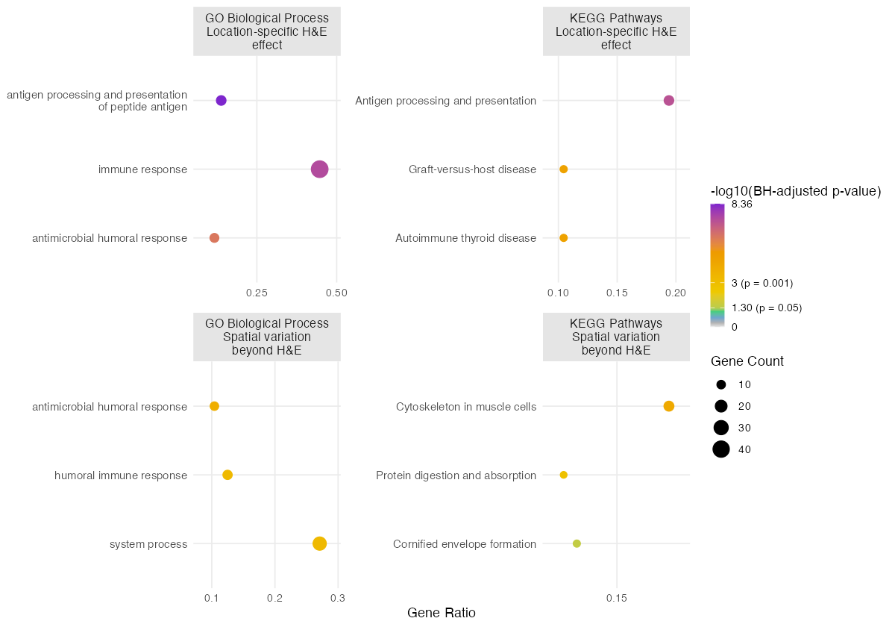

```{r setup, include=FALSE}
options(width = 240)
knitr::opts_chunk$set(collapse = TRUE, comment = "#>", fig.width = 9,
                     fig.height = 3.5, dpi = 120, fig.path = "figures/")
```

## Overview

MorphoANOVA examines how spatial gene expression relates to H&E morphology through four nested models (Figure 1b). M1 contains an intercept only. M2 adds a slide-wide H&E effect with a coefficient shared across the tissue, while M3 allows this coefficient to vary by location. M4 further captures spatial variation unexplained by the selected H&E feature. Sequential F-tests assess the evidence for each added component, while increments in adjusted R² summarize the variance explained by each component.

```{r model-comparisons, echo=FALSE, out.width="100%"}

```

The model uses two inputs:

- `expression`: a normalized or log-transformed numeric matrix with
  genes in rows and tissue spot IDs in columns.
- `spots`: a data frame with one row per location and columns `spot_id`,
  `x`, `y`, and `he`. These contain the spot ID, spatial coordinates,
  and one H&E feature value, respectively.

## Load the data

Download
[ovarian_full.rds](https://github.com/powei219/MorphoANOVA/blob/main/tutorial/data/ovarian_full.rds)
and
[tissue_hires_image.png](https://github.com/powei219/MorphoANOVA/blob/main/tutorial/data/tissue_hires_image.png).
The RDS file contains all 2,977 genes and coordinates for 3,455 tissue
spots from the [10x Genomics Human Ovarian Cancer
dataset](https://www.10xgenomics.com/datasets/human-ovarian-cancer-1-standard).
Expression is already `log1p(counts)`. We select 11 genes from this full
input for the examples below.

```{r load-data}
library(MorphoANOVA)

ovarian <- readRDS("ovarian_full.rds")
genes <- c("PRG4", "COL3A1", "JCHAIN", "C7", "CTSD", "MGP", "LYZ", "DCN",
           "IGHG4", "IGHM", "ANGPTL4")
expression <- ovarian$expression[genes, , drop = FALSE]
coordinates <- ovarian$coordinates

dim(expression)
rownames(expression)
```

## Extract the H&E feature

Next, we extract an H&E feature from the aligned image, tissue_hires_image.png. For each tissue spot, we calculate the mean red-channel intensity within a 15 × 11 pixel patch centered at the spot, as in our ovarian analysis.

To locate each spot in the image, the coordinate table must contain spot_id, x, and y. The function uses one-based pixel coordinates, where x refers to the image column and y refers to the image row. In this dataset, the coordinates are already in pixels, but the y-axis points upward rather than downward. We therefore set flip_y = TRUE to match the image orientation.

For other datasets, if x and y are in different units (e.g., micrometers), first convert them to image-pixel coordinates using the appropriate scaling factors or image registration information. Store these in separate columns (pixel_x and pixel_y) and specify pixel_columns = c("pixel_x", "pixel_y").

```{r extract-he, fig.width=9, fig.height=4.5}
he <- extract_he_feature("tissue_hires_image.png", coordinates,
                         channel = "red", patch_size = c(15, 11),
                         pixel_columns = c("x", "y"), flip_y = TRUE)
spots <- he$spots
head(he$spots)
he$preview
```

The extracted feature is stored in `spots$he`. You can also supply a
feature extracted with another method in this column.

## Fit IGHM and read the outputs

k = 30 is a tuning parameter that sets the basis dimension for each spatial smooth. Larger values allow more complex spatial patterns but increase computation.

```{r single-fit}
fit_one <- fit_morphoanova(expression, spots, genes = "IGHM", k = 30)
```

### Interpreting histology–gene expression relationships

fit_one$statistics summarizes three types of spatial expression patterns: slide-wide associations with H&E morphology (F21), location-specific associations (F32), and additional spatial variation unexplained by the selected H&E feature (F43). The corresponding p and q columns report unadjusted and BH-adjusted p-values.

For IGHM, the variance explained by slide-wide H&E associations, location-specific associations, and additional spatial variation is 18.4%, 20.0%, and 41.6%, respectively, based on increments in adjusted R². This suggests that IGHM expression is associated with tissue morphology, but a substantial portion of its spatial variation is not captured by the selected H&E feature.

```{r gene-statistics}
fit_one$statistics[c("gene", "F21", "p21", "q21", "F32", "p32", "q32", "F43", "p43", "q43")]
fit_one$statistics[c("gene", "r2_slide_wide_he", "r2_location_specific_he", "r2_spatial_beyond_he", "r2_full", "r2_unexplained_variance")]
```

### Spatial patterns of IGHM expression

fit_one$spatial[["IGHM"]] provides spot-level expression and fitted components. total_he combines the slide-wide and location-specific H&E contributions, while spatial_beyond_he represents additional spatial variation unexplained by the selected H&E feature.

```{r fitted-values}
values <- fit_one$spatial[["IGHM"]]
head(values[c("spot_id", "expression", "fitted", "slide_wide_he", "location_specific_he", "total_he", "spatial_beyond_he")])
```

### Visualizing spatial patterns and significance

`plot_components()` visualizes IGHM expression and its morphogenomic components.

```{r components, fig.height=4}
plot_components(fit_one, gene = "IGHM")
```

For each tissue spot, two-sided Wald tests assess whether the total H&E-associated effect or the additional spatial effect unexplained by the selected H&E feature differs from zero. The p-values are BH-adjusted across spots, separately for each gene and component, with q representing the adjusted p-values.

The significance maps highlight spots with q <= 0.05. The blue scale represents -log10(q), capped at 20.

```{r significance, fig.width=6.5, fig.height=4}
plot_components(fit_one, gene = "IGHM", type = "significance")
```

The spot-level p-values and adjusted p-values can also be accessed directly:

```{r pointwise-values}
head(values[c("spot_id", "total_he_p", "total_he_q", "spatial_beyond_he_p", "spatial_beyond_he_q")])
```

## Multi-gene analysis

MorphoANOVA can fit multiple genes in a single run. Here, we analyze all 11 example genes. We then use plot_scatter() to visualize their spatial patterns and rank_genes() to identify genes with strong contributions to each spatial component.

```{r batch-fit, fig.height=4.5}
fit <- fit_morphoanova(expression, spots, k = 30)
plot_scatter(fit, point_size = 1)
```

To identify genes with strong contributions to each spatial component, rank_genes() first filters genes based on the variance explained by each component (increment in adjusted R² >= 0.03 by default), then ranks them by the corresponding F-statistic. Here, we select the top three genes for each component.

```{r ranking}
ranked <- rank_genes(fit, top_n = 3)
ranked$location_specific_he
ranked$spatial_beyond_he
```

Among these 11 genes, IGHG4, PRG4, and IGHM rank highest for location-specific H&E associations, while ANGPTL4, C7, and DCN rank highest for additional spatial variation beyond the selected H&E feature.

To apply different selection criteria to each spatial component, specify named values for top_n and min_r2.

```{r ranking-options, eval=FALSE}
ranked_custom <- rank_genes(
  fit,
  top_n = c(location_specific_he = 3, spatial_beyond_he = 5),
  min_r2 = c(location_specific_he = 0.03, spatial_beyond_he = 0.05)
)
```

## Downstream biological interpretation

We further explore the biological relevance of MorphoANOVA components through tissue-composition correlations and functional enrichment analysis.

We examine how the fitted components relate to the proportions of lymphocyte, macrophage, tumor, stroma, blood, and necrosis at each tissue spot.
`proportions` contains `spot_id` and one numeric column
per tissue category; `genes` selects the genes to display.

```{r correlation-heatmap, fig.height=5}
proportions <- ovarian$proportions
plot_composition(fit, proportions, genes = rownames(expression))
```

Next, we extend the analysis to all 2,977 genes in the ovarian dataset
to investigate their biological functions.

```{r full-scan, eval=FALSE}
fit_full <- fit_morphoanova(ovarian$expression, spots, k = 30, cores = 4)
plot_scatter(fit_full)
```

```{r full-scatter, echo=FALSE, out.width="80%"}

```

We select the top 100 genes for each spatial component and use
`plot_enrichment()` to run GO and KEGG enrichment and draw the results.

The `top_n` in `rank_genes()` selects genes for enrichment. In
`plot_enrichment()`, `top_n = 3` displays up to three terms per component
and database, ordered by increasing BH-adjusted p-value.

```{r enrichment, eval=FALSE}
# Install once if needed:
# install.packages("BiocManager")
# BiocManager::install(c("clusterProfiler", "org.Hs.eg.db"))

ranked_full <- rank_genes(fit_full, top_n = 100, min_r2 = 0.03)
plot_enrichment(ranked_full, top_n = 3)
```



## Data sources

Expression, coordinates and the original H&E image come from the [10x
Genomics Human Ovarian Cancer
dataset](https://www.10xgenomics.com/datasets/human-ovarian-cancer-1-standard)
(2022-03-28), licensed under [CC BY
4.0](https://creativecommons.org/licenses/by/4.0/). Expression is
`log1p(counts)` after retaining genes with raw-count standard deviation
greater than 2.

Tissue-category counts are from Jiang et al., [iIMPACT, Zenodo version
v1](https://doi.org/10.5281/zenodo.11117768) (2024-05-06), also under CC
BY 4.0. Counts were matched by spot ID and divided by their row totals
to obtain proportions for lymphocyte, macrophage, tumor, stroma, blood
and necrosis.
